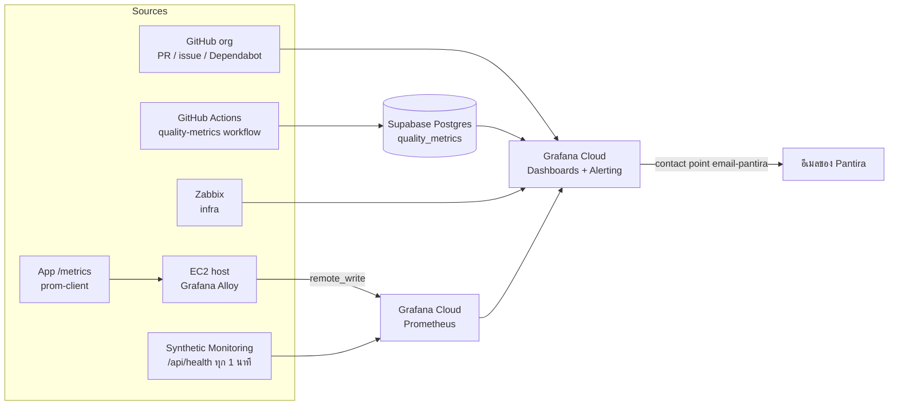

# 5.8 การตั้งค่า Grafana Monitoring — Grafana Monitoring Setup

## วัตถุประสงค์

เอกสารนี้อธิบายการตั้งค่า **Grafana Cloud** (เริ่มที่ free tier) ให้เป็นที่เดียวสำหรับติดตามสัญญาณใน [5.7 Continuous Monitoring](5.7_Continuous_Monitoring.md) และ Dev quality metrics (coverage, vulnerability, test result) ของ **ทุกโปรเจกต์ใน GitHub org** พร้อม Alert ทาง Email ถึง Pantira

> **ขอบเขต:** ส่งมอบเป็นเอกสาร + template ใน repo นี้ ([`templates/grafana/`](../../templates/grafana/), [`templates/workflows/`](../../templates/workflows/)) — การนำไปใช้กับ app repo / org ทั้งหมดเป็นขั้นตอนถัดไป
> **Owner:** Pantira | **เวลาทำการ:** 07:30–16:30 จ.–ศ. (Asia/Bangkok = 00:30–09:30 UTC)

---

## 1. สถาปัตยกรรม

---

## 2. ขั้นตอนการตั้งค่า

### ขั้นที่ 1: สร้าง Grafana Cloud stack

1. สมัคร/เข้า Grafana Cloud แล้วสร้าง stack (แผน Free)
2. ตั้ง timezone ของ org/dashboard เป็น `Asia/Bangkok`
3. เก็บ URL ของ stack, และสร้าง Access Policy token สำหรับ Alloy (scope `metrics:write`) — เก็บใน secret ไม่ commit

### ขั้นที่ 2: เพิ่ม Data sources

| Data source | วิธีตั้งค่า |
|:------------|:------------|
| Prometheus | มีมาให้ใน Grafana Cloud (Mimir) — รับ metric จาก Alloy และ Synthetic Monitoring |
| GitHub | ติดตั้ง plugin GitHub data source ใส่ org และ token สิทธิ์ **read-only** เท่าที่จำเป็น (เช่น repo metadata, pull requests, issues, Dependabot alerts read) |
| PostgreSQL (Supabase) | host/port ของ Supabase, database, **read-only DB user** (สิทธิ์ `SELECT` บน `quality_metrics` เท่านั้น), SSL required |
| Zabbix | ติดตั้ง Zabbix plugin ชี้ไป Zabbix API ที่มีอยู่แล้ว (infra) ด้วย user read-only |

### ขั้นที่ 3: Synthetic Monitoring check ต่อโปรเจกต์

- สร้าง HTTP check ไปที่ `/api/health` ทุก **1 นาที** (Probe ในภูมิภาคที่ใกล้ที่สุด)
- ใส่ label `project=<ชื่อ repo>` ทุก check
- ผลอยู่ใน metric `probe_success` ใช้คำนวณ Availability เฉพาะเวลาทำการ (00:30–09:30 UTC จ.–ศ.)

### ขั้นที่ 4: ติดตั้ง Alloy และ app metrics

- Alloy บน EC2: [`templates/grafana/alloy/config.alloy`](../../templates/grafana/alloy/config.alloy) — scrape `/metrics` แล้ว remote_write ไป Grafana Cloud (ใส่ endpoint/credential ผ่าน environment variable)
- App: [`templates/grafana/app-metrics/metrics.ts`](../../templates/grafana/app-metrics/metrics.ts) — histogram `http_server_request_duration_seconds {project, route, method, status}`, counters `job_runs_total` / `job_failures_total {project, job}`, endpoint `GET /metrics`

### ขั้นที่ 5: Supabase table + reusable workflow + repo secrets

1. รัน DDL: [`templates/grafana/quality_metrics.sql`](../../templates/grafana/quality_metrics.sql) ได้ตาราง `quality_metrics(id, project, repo, metric, value, ref, sha, run_id, created_at)`
2. คัดลอก [`templates/workflows/quality-metrics.yml`](../../templates/workflows/quality-metrics.yml) ไปที่ `.github/workflows/` (หรือ org `.github` repo ภายหลัง)
3. App repo เรียกใช้ด้วย `uses: Siam-GS-Battery/SOP-SDLC-PLAN/.github/workflows/quality-metrics.yml@main` โดยส่ง input `project`
4. ตั้ง repo/org secrets: `SUPABASE_URL`, `SUPABASE_SERVICE_KEY`

metric ที่บันทึก: `coverage_lines_pct`, `new_code_coverage_pct`, `audit_critical`, `audit_high`, `tests_passed` (1/0)

### ขั้นที่ 6: Import dashboards

- [`executive-overview.json`](../../templates/grafana/dashboards/executive-overview.json) — ภาพรวมผู้บริหาร
- [`project-drilldown.json`](../../templates/grafana/dashboards/project-drilldown.json) — รายโปรเจกต์
- Dashboards > New > Import แล้วเลือก data source ให้ตรง; ทั้งสองมีตัวแปร `$project`

### ขั้นที่ 7: Provision alerts + email contact point

- [`alerts/contact-points.yaml`](../../templates/grafana/alerts/contact-points.yaml) — contact point `email-pantira` (ใส่ **อีเมลของ Pantira** ใน Grafana เอง ห้ามเขียนลง repo)
- [`alerts/alert-rules.yaml`](../../templates/grafana/alerts/alert-rules.yaml) — กฎตามเกณฑ์ 5.7:

| Alert | เกณฑ์ |
|:------|:------|
| Health check | ล้มเหลวต่อเนื่อง 3 ครั้ง (ตรวจพบ ≈ 3 นาที) |
| Availability | < 99.5% ต่อเดือน (เวลาทำการ) |
| 5xx | Warning > 1% / Critical > 5% ใน 5 นาที |
| Latency P95 | > 500 ms ต่อเนื่อง 10 นาที |
| Failed background job | `job_failures_total` เพิ่ม >= 1 |
| Recovery time | แจ้ง escalate เมื่อใกล้ 1 วัน |

### ขั้นที่ 8: Checklist เมื่อเพิ่มโปรเจกต์ใหม่ (Onboarding)

- [ ] ตั้งชื่อ label `project=<ชื่อ repo>` ให้สอดคล้องทุกแหล่ง (Synthetic, Alloy, workflow input)
- [ ] ตั้ง secrets `SUPABASE_URL`, `SUPABASE_SERVICE_KEY` ใน repo/org
- [ ] เพิ่ม Synthetic Monitoring HTTP check `/api/health` ทุก 1 นาที
- [ ] app มี `/api/health` และ `/metrics` (ใช้ `metrics.ts`) และ Alloy scrape แล้ว
- [ ] เพิ่ม workflow เรียก `quality-metrics.yml` ด้วย input `project`
- [ ] ตรวจว่าโปรเจกต์ปรากฏในตัวแปร `$project` ของ dashboard
- [ ] ยืนยันว่า Alert ส่งถึง `email-pantira` (ทดสอบ)

---

## 3. แผนการทำทีละ Phase

| Phase | ขอบเขต |
|:-----:|:-------|
| 1 | GitHub data source + Zabbix + Synthetic Monitoring + Alerts (Email) |
| 2 | CI quality metrics (Supabase `quality_metrics` + reusable workflow) |
| 3 | App metrics (`/metrics` + Alloy): 5xx, latency P95, failed jobs |
| 4 | MTTR จาก Service Desk/Jira — **TBD** (ยังไม่กำหนดแหล่งข้อมูล) |

---

## 4. การจับคู่ KPI กับแหล่งข้อมูล

| KPI (Executive 6 ตัว) | แหล่งข้อมูล | Panel | สถานะ |
|:----------------------|:------------|:------|:------|
| SDLC compliance | ไม่มีแหล่งอัตโนมัติ — ผล audit ประจำเดือน (กรอกมือ) | Stat (manual) ใน executive-overview | **TBD / นอก Grafana (manual)** |
| Release ผ่าน gates | Postgres `quality_metrics` (`tests_passed`, `coverage_lines_pct`, `new_code_coverage_pct`) + GitHub | Stat/Table ใน executive-overview | Phase 2 |
| Security critical open | Postgres `audit_critical` / `audit_high` + GitHub Dependabot | Stat/Table ใน executive-overview, project-drilldown | Phase 1–2 |
| Availability | Prometheus `probe_success` (Synthetic Monitoring) เวลาทำการ | Gauge/Stat ใน executive-overview | Phase 1 |
| Recovery time | Service Desk/Jira (MTTR) | Stat ใน executive-overview | **TBD** (Phase 4) |
| Usage และ Satisfaction | ไม่มีแหล่งอัตโนมัติ | — | **TBD / นอก Grafana (manual)** |

---

## 5. ข้อควรระวังด้านความปลอดภัย

- เก็บ token/key ทั้งหมด (Grafana Access Policy, GitHub token, `SUPABASE_SERVICE_KEY`) ใน secret manager / GitHub secrets — **ห้าม commit** ลง repo
- Postgres data source ใน Grafana ใช้ **read-only DB role** เท่านั้น; `SUPABASE_SERVICE_KEY` ใช้เฉพาะใน CI เพื่อเขียนข้อมูล
- GitHub token ให้สิทธิ์ read-only น้อยที่สุดที่จำเป็น และกำหนดวันหมดอายุ
- ห้ามเขียนอีเมลหรือข้อมูลส่วนตัวลงไฟล์ provisioning ที่ commit — กรอกใน Grafana โดยตรง

---

[กลับไปหน้า Deploy](INDEX.md)
