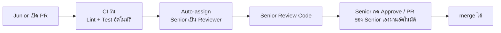

# 7.5 GitHub Actions CI Template

## ภาพรวม

เอกสารนี้เป็น **Template** สำหรับตั้งค่า GitHub Actions CI ที่ทำงานตาม PR Workflow ของทีม สามารถ copy ไปใส่โปรเจกต์ของตัวเองได้เลย

### Flow ที่ Template นี้ทำ



---

## ไฟล์ที่ต้องสร้าง

```
your-project/
└── .github/
    └── workflows/
        ├── ci.yml                  ← รัน Lint + Test ทุก PR
        └── pr-approval-gate.yml    ← ตรวจ Senior Approval (Senior เปิดเอง หรือมี Senior อื่น Approve)
```

---

## ไฟล์ที่ 1: `ci.yml` — รัน CI + Auto-assign Reviewer

Copy ไฟล์นี้ไปวางที่ `.github/workflows/ci.yml`

```yaml
# =============================================================
# CI Pipeline — รัน Lint + Test ทุก Pull Request
# =============================================================
# วิธีใช้:
#   1. Copy ไฟล์นี้ไปวางที่ .github/workflows/ci.yml
#   2. แก้ SENIOR_REVIEWER เป็น GitHub username ของ Senior
#   3. แก้ working-directory ถ้าโครงสร้างโปรเจกต์ต่างออกไป
# =============================================================

name: CI

on:
  pull_request:
    branches: [main, develop, staging]

env:
  # ==============================
  # แก้ตรงนี้: ใส่ GitHub username ของ Senior
  # ==============================
  SENIOR_REVIEWER: "senior-github-username"

jobs:
  # -----------------------------------------------------------
  # Job 1: Lint & Type Check
  # -----------------------------------------------------------
  lint:
    name: Lint & Type Check
    runs-on: ubuntu-latest
    steps:
      - uses: actions/checkout@v4

      - uses: actions/setup-node@v4
        with:
          node-version: "18"
          cache: "npm"

      # แก้ working-directory ถ้า package.json ไม่ได้อยู่ root
      - name: Install dependencies
        run: npm ci

      - name: Run Lint
        run: npm run lint

      # ถ้าโปรเจกต์ใช้ TypeScript ให้เปิด step นี้
      # - name: Type Check
      #   run: npm run type-check

  # -----------------------------------------------------------
  # Job 2: Test
  # -----------------------------------------------------------
  test:
    name: Run Tests
    runs-on: ubuntu-latest
    needs: lint
    steps:
      - uses: actions/checkout@v4

      - uses: actions/setup-node@v4
        with:
          node-version: "18"
          cache: "npm"

      - name: Install dependencies
        run: npm ci

      - name: Run Tests
        run: npm test

      # ถ้าต้องการ coverage report ให้เปิด step นี้
      # - name: Run Tests with Coverage
      #   run: npm run test:coverage

  # -----------------------------------------------------------
  # Job 3: Coverage ของโค้ดใหม่/ที่แก้ใน PR ต้อง >= NEW_CODE_COVERAGE_MIN %
  # -----------------------------------------------------------
  coverage:
    name: New Code Coverage
    runs-on: ubuntu-latest
    needs: test
    env:
      NEW_CODE_COVERAGE_MIN: 70
    steps:
      - uses: actions/checkout@v4
        with:
          fetch-depth: 0

      - name: Check if package.json exists
        id: check
        run: |
          if [ -f package.json ]; then
            echo "has_package=true" >> $GITHUB_OUTPUT
          else
            echo "has_package=false" >> $GITHUB_OUTPUT
            echo "No package.json found — skipping coverage (docs-only repo)"
          fi

      - uses: actions/setup-node@v4
        if: steps.check.outputs.has_package == 'true'
        with:
          node-version: "18"
          cache: "npm"

      - name: Install dependencies
        if: steps.check.outputs.has_package == 'true'
        run: npm ci

      - name: Run Tests with Coverage (lcov)
        if: steps.check.outputs.has_package == 'true'
        run: npm test -- --coverage --coverageReporters=lcov

      - name: Fail if new-code coverage is below minimum
        if: steps.check.outputs.has_package == 'true'
        run: |
          pip install diff-cover
          diff-cover coverage/lcov.info \
            --compare-branch=origin/${{ github.base_ref }} \
            --fail-under=${{ env.NEW_CODE_COVERAGE_MIN }}

  # -----------------------------------------------------------
  # Job 4: Security — fail เมื่อพบช่องโหว่ระดับ critical
  # -----------------------------------------------------------
  audit:
    name: Dependency Audit
    runs-on: ubuntu-latest
    steps:
      - uses: actions/checkout@v4

      - name: Check if package.json exists
        id: check
        run: |
          if [ -f package.json ]; then
            echo "has_package=true" >> $GITHUB_OUTPUT
          else
            echo "has_package=false" >> $GITHUB_OUTPUT
            echo "No package.json found — skipping npm audit (docs-only repo)"
          fi

      - uses: actions/setup-node@v4
        if: steps.check.outputs.has_package == 'true'
        with:
          node-version: "18"

      - name: npm audit (fail on critical)
        if: steps.check.outputs.has_package == 'true'
        run: npm audit --audit-level=critical

  # -----------------------------------------------------------
  # Job 5: Auto-assign Senior เป็น Reviewer
  # -----------------------------------------------------------
  assign-reviewer:
    name: Assign Senior Reviewer
    runs-on: ubuntu-latest
    if: github.event.action == 'opened'
    permissions:
      pull-requests: write
    steps:
      - name: Request review from Senior
        uses: actions/github-script@v7
        with:
          script: |
            const reviewer = process.env.SENIOR_REVIEWER;
            const prAuthor = context.payload.pull_request.user.login;

            // ไม่ assign ตัวเอง (กรณี Senior เปิด PR เอง)
            if (prAuthor === reviewer) {
              console.log('PR author is the reviewer, skipping auto-assign');
              return;
            }

            await github.rest.pulls.requestReviewers({
              owner: context.repo.owner,
              repo: context.repo.repo,
              pull_number: context.issue.number,
              reviewers: [reviewer]
            });

            console.log(`Assigned ${reviewer} as reviewer`);
```

### เช็กเพิ่มเติม 2 รายการ (Job 3-4)

- **New Code Coverage** — รันเทสต์พร้อม coverage (lcov) แล้วใช้ `diff-cover` ตรวจเฉพาะบรรทัดที่เพิ่ม/แก้ใน PR ถ้า coverage ต่ำกว่า `NEW_CODE_COVERAGE_MIN` (ค่าเริ่มต้น 70%) job จะ fail (ต้องใช้ `fetch-depth: 0` เพื่อเทียบกับ base branch)
- **Dependency Audit** — รัน `npm audit --audit-level=critical` ถ้าพบช่องโหว่ระดับ critical จะ fail
- ทั้งสอง job จะ skip อัตโนมัติถ้าไม่มี `package.json` (docs-only repo)

---

## ไฟล์ที่ 2: `pr-approval-gate.yml` — ตรวจ Senior Approval (either/or)

Copy ไฟล์นี้ไปวางที่ `.github/workflows/pr-approval-gate.yml`

```yaml
# =============================================================
# PR Approval Gate — Senior Approval (either/or)
# =============================================================
# ผ่านเมื่อ: (a) ผู้เปิด PR เป็น Senior (Senior self-merge)
#        หรือ (b) มี Approved review จาก Senior ที่ไม่ใช่ผู้เปิด PR
# ข้อยกเว้นชั่วคราวสำหรับทีมที่มี Senior คนเดียว — ทบทวนเมื่อมี Senior คนที่ 2
# วิธีใช้:
#   1. Copy ไฟล์นี้ไปวางที่ .github/workflows/pr-approval-gate.yml
#   2. แก้ SENIOR_REVIEWER เป็น GitHub username ของ Senior (หลายคนคั่นด้วย comma)
#   3. ตั้ง Branch Protection Rule ให้ require status check "Senior Approval"
# =============================================================

name: PR Approval Gate

on:
  pull_request:
    types: [opened, reopened, synchronize]
  pull_request_review:
    types: [submitted, dismissed]

env:
  # คั่นด้วย comma ถ้ามี Senior หลายคน
  SENIOR_REVIEWER: "senior-github-username"

jobs:
  check-approval:
    name: Check Senior Approval
    runs-on: ubuntu-latest
    permissions:
      pull-requests: read
      statuses: write
    steps:
      - name: Evaluate Senior Approval
        uses: actions/github-script@v7
        with:
          script: |
            const seniors = process.env.SENIOR_REVIEWER.split(',').map(s => s.trim().toLowerCase());
            const pr = context.payload.pull_request;
            const author = pr.user.login.toLowerCase();

            // (a) ผู้เปิด PR เป็น Senior -> Senior self-merge
            let ok = seniors.includes(author);
            let desc = ok ? `Senior self-merge (@${pr.user.login})` : '';

            // (b) มี Approved review จาก Senior ที่ไม่ใช่ผู้เปิด PR (นับ review ล่าสุดของแต่ละคน)
            if (!ok) {
              const reviews = await github.paginate(github.rest.pulls.listReviews, {
                owner: context.repo.owner,
                repo: context.repo.repo,
                pull_number: pr.number
              });
              const latest = {};
              for (const r of reviews) {
                if (r.state === 'COMMENTED') continue;
                latest[r.user.login.toLowerCase()] = r.state;
              }
              const approver = Object.keys(latest).find(
                u => latest[u] === 'APPROVED' && seniors.includes(u) && u !== author
              );
              ok = !!approver;
              desc = ok ? `Approved by @${approver}` : 'Waiting for Senior approval';
            }

            await github.rest.repos.createCommitStatus({
              owner: context.repo.owner,
              repo: context.repo.repo,
              sha: pr.head.sha,
              state: ok ? 'success' : 'pending',
              context: 'Senior Approval',
              description: desc
            });
```

---

## ตั้งค่า Branch Protection Rules (ห้าม merge เมื่อ CI แดง)

ตั้งค่าให้ GitHub **บล็อกปุ่ม Merge** เมื่อ CI ไม่ผ่านหรือยังไม่มี Senior Approval — ไม่ต้องพึ่งวินัยของคน

### ชื่อ check ที่ต้องเลือก (ตรงกับ `name:` ของแต่ละ job ใน `ci.yml`)

| Job ID | ชื่อที่แสดงใน GitHub Checks | Required? |
|:-------|:----------------------------|:----------|
| `lint` | `Lint & Type Check` | ✅ Required |
| `test` | `Run Tests` | ✅ Required |
| `audit` | `Dependency Audit` | ✅ Required |
| `pr-approval-gate.yml` | `Senior Approval` | ✅ Required |
| `coverage` | `New Code Coverage` | ⚠️ Advisory ช่วง 1–2 Sprint แรก แล้วค่อยเพิ่มเป็น Required |

> **หมายเหตุ:** Check จะโผล่ในรายการให้เลือกได้ **ก็ต่อเมื่อเคยรันบน PR อย่างน้อย 1 ครั้ง** — เปิด PR ทดลองก่อนแล้วค่อยมาตั้งค่า

### ขั้นตอนผ่าน GitHub UI

1. ไปที่ **Settings → Branches** (หรือ **Settings → Rules → Rulesets**) → **Add rule**
2. Branch name pattern: `main`
3. เปิด **Require a pull request before merging** และตั้ง **Required approvals = 0** (การบังคับ Senior ทำผ่าน check `Senior Approval` แทน — เพราะทีมมี Senior คนเดียวและ GitHub ไม่ให้ผู้เปิด PR approve PR ตัวเอง)
4. เปิด **Require status checks to pass before merging**
5. ค้นหาและเลือก checks: `Lint & Type Check`, `Run Tests`, `Dependency Audit`, `Senior Approval`
6. เปิด **Require branches to be up to date before merging**
7. (Optional) เปิด **Do not allow bypassing the above settings** — แม้ admin ก็ต้องผ่าน
8. กด **Create / Save changes**

เมื่อ Sprint ที่ 2–3 ผ่านไป และทีมคุ้นกับ coverage gate แล้ว ให้กลับมาเพิ่ม `New Code Coverage` เป็น required check

### ทางเลือก: ตั้งผ่าน `gh api` (ตัวอย่าง)

> ตัวอย่างเท่านั้น — แก้ `{owner}/{repo}` และ context ให้ตรงกับ repo ของคุณ ต้องมีสิทธิ์ admin

```bash
gh api -X PUT repos/{owner}/{repo}/branches/main/protection \
  --input - <<'EOF'
{
  "required_status_checks": {
    "strict": true,
    "contexts": ["Lint & Type Check", "Run Tests", "Dependency Audit", "Senior Approval"]
  },
  "enforce_admins": true,
  "required_pull_request_reviews": { "required_approving_review_count": 0 },
  "restrictions": null
}
EOF
```

---

## Dependabot

สำหรับ **app repo ที่มี `package.json`** — ให้ Dependabot เปิด PR อัปเดต dependency และแพตช์ช่องโหว่อัตโนมัติ (repo ที่เป็น docs-only ไม่ต้องใช้ส่วน npm)

Copy ไปวางที่ `.github/dependabot.yml`:

```yaml
version: 2
updates:
  - package-ecosystem: "npm"
    directory: "/"            # แก้ถ้า package.json ไม่ได้อยู่ root
    schedule:
      interval: "weekly"
    open-pull-requests-limit: 5

  # (Optional) อัปเดต version ของ actions ใน workflow
  - package-ecosystem: "github-actions"
    directory: "/"
    schedule:
      interval: "weekly"
```

PR จาก Dependabot จะผ่าน CI + Branch Protection เหมือน PR ปกติ

นโยบายการแก้ช่องโหว่ (SLA) ดูที่ [6.5 Security Test Guide](../06_TESTING/6.5_Security_Test_Guide.md):

- **critical** → CI fail ทันที (`Dependency Audit`)
- **high** → แก้ภายใน 14 วัน
- **moderate / low** → เคลียร์รวมเดือนละครั้ง

---

## วิธีใช้งานจริง

### สำหรับ Junior

```
1. เขียน code เสร็จ → Push → เปิด PR
2. รอ CI รัน (Lint + Test)
   - ถ้า CI ❌ fail → แก้ code แล้ว push ใหม่
   - ถ้า CI ✅ pass → รอ Senior review
3. Senior จะถูก assign อัตโนมัติ
4. แก้ตาม feedback ของ Senior
5. เมื่อ Senior กด **Approve** (Review → Approve) → `Senior Approval` ผ่าน → merge ได้
```

### สำหรับ Senior

```
1. ได้รับ notification ว่ามี PR ใหม่ (auto-assigned)
2. ตรวจ CI ผ่านหรือไม่
   - ถ้า CI fail → แจ้ง Junior แก้ก่อน ไม่ต้อง review
3. Review code ตาม 4 ระดับ (MUST / SHOULD / NIT / LEARN)
4. ถ้าต้องแก้ → Request Changes
5. ถ้าผ่าน → กด **Approve** ใน PR
6. `Senior Approval` เปลี่ยนเป็น ✅ แล้ว Junior merge ได้
7. **PR ที่ Senior เปิดเอง:** `Senior Approval` ผ่านอัตโนมัติ — Senior merge เองได้เมื่อ CI เขียว + กรอก PR Template + ติ๊ก Self-review checklist ครบ

> **ข้อยกเว้นชั่วคราว (ทีมมี Senior คนเดียว):** ทบทวนกฎ self-merge นี้เมื่อมี Senior/reviewer คนที่ 2 แล้วกลับไปบังคับให้ต้องมี Approve จากคนที่ไม่ใช่ผู้เปิด PR
```

---

## ปรับแต่งเพิ่มเติม

### โปรเจกต์ที่มี Frontend + Backend แยกโฟลเดอร์

ถ้าโปรเจกต์มีโครงสร้างแบบนี้:

```
project/
├── frontend/
│   └── package.json
└── backend/
    └── package.json
```

แก้ `ci.yml` ให้รัน CI แยกกัน:

```yaml
jobs:
  lint-frontend:
    name: Lint Frontend
    runs-on: ubuntu-latest
    defaults:
      run:
        working-directory: ./frontend
    steps:
      - uses: actions/checkout@v4
      - uses: actions/setup-node@v4
        with:
          node-version: "18"
      - run: npm ci
      - run: npm run lint

  lint-backend:
    name: Lint Backend
    runs-on: ubuntu-latest
    defaults:
      run:
        working-directory: ./backend
    steps:
      - uses: actions/checkout@v4
      - uses: actions/setup-node@v4
        with:
          node-version: "18"
      - run: npm ci
      - run: npm run lint

  test-frontend:
    name: Test Frontend
    runs-on: ubuntu-latest
    needs: lint-frontend
    defaults:
      run:
        working-directory: ./frontend
    steps:
      - uses: actions/checkout@v4
      - uses: actions/setup-node@v4
        with:
          node-version: "18"
      - run: npm ci
      - run: npm test

  test-backend:
    name: Test Backend
    runs-on: ubuntu-latest
    needs: lint-backend
    defaults:
      run:
        working-directory: ./backend
    steps:
      - uses: actions/checkout@v4
      - uses: actions/setup-node@v4
        with:
          node-version: "18"
      - run: npm ci
      - run: npm test
```

### เพิ่ม Senior หลายคน

`pr-approval-gate.yml` รองรับหลายคนอยู่แล้ว — ใส่ username คั่นด้วย comma:

```yaml
env:
  SENIOR_REVIEWER: "senior1-username,senior2-username"
```

เมื่อมี Senior คนที่ 2 ให้ทบทวนข้อยกเว้น Senior self-merge (7.3) และพิจารณาตั้ง required approvals ≥ 1 กลับมา

---

## Checklist การติดตั้ง

- [ ] Copy `ci.yml` ไปวางที่ `.github/workflows/ci.yml`
- [ ] Copy `pr-approval-gate.yml` ไปวางที่ `.github/workflows/pr-approval-gate.yml`
- [ ] แก้ `SENIOR_REVIEWER` เป็น GitHub username จริง
- [ ] แก้ `working-directory` ตามโครงสร้างโปรเจกต์ (ถ้าจำเป็น)
- [ ] ตั้ง Branch Protection Rules ใน GitHub Settings
- [ ] ทดสอบโดยเปิด PR ทดลอง
- [ ] ตรวจว่า CI รัน + Senior ถูก assign อัตโนมัติ

---

## เอกสารที่เกี่ยวข้อง

- [7.3 Pull Request Process](7.3_Pull_Request_Process.md) — PR Workflow ที่ CI นี้รองรับ
- [7.4 Code Review Guidelines](7.4_Code_Review_Guidelines.md) — วิธี Review Code (4 ระดับ Comment)
- [5.1 Deploy Overview](../05_DEPLOY/5.1_Deploy_Overview.md) — Release Cadence + Runbooks

---

*อัปเดตล่าสุด: 1 เมษายน 2026*
